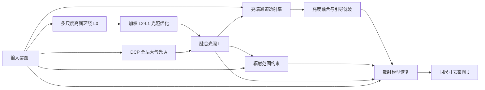

# Retinex-BDCP：固定参数的光照感知去雾

本实现组合 DCP、多尺度 Retinex 和亮暗通道先验，输出与输入同尺寸的 RGB 图像。
它不训练参数，也不修改 YOLO。它是一个可进行消融实验的工程版本，尚未证明检测效果优于原图或 DCP。
原有 `DarkChannelPrior`、`Retinex` 和 `HybridDehazer` 保留，默认检测流水线的算法不变。

## 公式来源与实现边界

| 论文 | 本实现使用的内容 | 与原文的区别 |
|---|---|---|
| He, Sun, Tang, *Single Image Haze Removal Using Dark Channel Prior*, CVPR 2009（用户提供的 `DCP.pdf`） | 暗通道；最高 0.1% 暗通道像素中的大气光估计；式 (12) 的残雾系数；式 (16) 的辐射恢复 | 复用仓库的灰度引导滤波，而非论文 soft matting |
| Jobson, Rahman, Woodell, *A Multiscale Retinex for Bridging the Gap Between Color Images and the Human Observation of Scenes*, TIP 1997 | 第 III 节式 (1)–(2)：高斯环绕与多尺度对数差 | 从等权 MSR 推导有效环绕光照，不直接把 MSRCR 输出与 DCP 图像平均；OpenCV 的 sigma 与论文高斯尺度常数定义不同 |
| Liu et al., *Nighttime image dehazing via Retinex theory and bright-dark channel priors*, Urban Informatics (2026) 5:5，DOI `10.1007/s44212-025-00087-7`（`夜间去雾.pdf`） | 式 (4) 空间变化光照模型；式 (6) 光照正则化；式 (19)–(21) 亮暗通道与融合 | 采用可凸求解的 p=1 特例；数据项参考多尺度环绕 L0；增加全局/局部光照融合与辐射范围约束；非逐项复现 |

原文中以下歧义已明确处理：

- 夜间论文式 (19) 的暗通道分子写作未知清晰图 `J`。这里使用观测图 `I`，与散射模型和 DCP 推导一致。
- 式 (21) 的 `P_light` 与 `W_light` 混用。这里两项均使用同一权重 `w`，两权重之和为 1。
- 式 (16) 的普通 soft threshold 是 p=1 时的精确近端解，不能称为一般 p<1 的精确求解。实现明确固定 p=1。
- 式 (22) 只在分母使用透射率下限，低透射率时不再等价于 DCP 式 (16)。这里在减法项和分母中统一使用受约束的透射率。
- 论文没有充分给出可直接复用的权重 W、全部数值参数及边界设置。下述取值是本项目的工程定义，不冒充作者参数。

## 算法

输入 RGB uint8，首先归一化为 I∈[0,1]。以下运算不改变图像几何位置。



### 1. 多尺度光照初值

MSR 的对数差可写为：

\[
R^c_{MSR}=\log(I^c+\epsilon)-\sum_k a_k\log[G_{\sigma_k}*(I^c+\epsilon)].
\]

因此取其对应的有效环绕作为光照初值：

\[
L_0^c=\exp\left(\sum_k a_k\log[G_{\sigma_k}*(I^c+\epsilon)]\right)-\epsilon.
\]

使用三个等权高斯尺度，epsilon=1/255。尺度以输入图像像素为单位；光照估计降采样时同步缩放 sigma。
复用现有 Retinex 的大 sigma 加速函数，该函数本身包含降采样近似。
这里估计的是低频环绕，不能声称已唯一分离真实反射率与照明。

### 2. 加权 L2-L1 光照优化

\[
\widehat L=\arg\min_L \frac12\|L-L_0\|_F^2+
\lambda_2\sum_{j=x,y}\|W_j\odot S_jL\|_F^2+
\lambda_1\sum_{j=x,y}\|W_j\odot S_jL\|_1.
\]

Sj 为归一化 Sobel 差分。本项目取：

\[
W_j(x)=\frac1{1+10\max_c |S_j L_0^c(x)|}.
\]

RGB 共用边缘权重；L2 项抑制波动，L1 项鼓励稀疏梯度。使用 ADMM，两个约束的惩罚参数均为 1。
令 Vj=SjL、Uj=SjL，Yj/Zj 为缩放对偶变量，则：

\[
(\mathrm{Id}+2\sum_j S_j^*S_j)L
=L_0+\sum_jS_j^*(V_j+Y_j+U_j+Z_j),
\]

\[
V_j=\frac{S_jL-Y_j}{1+2\lambda_2W_j^2},\qquad
U_j=\operatorname{soft}(S_jL-Z_j,\lambda_1W_j).
\]

随后 Yj←Yj+Vj−SjL，Zj←Zj+Uj−SjL。L 子问题通过 FFT 求解。
反射填充 8 像素后使用周期算子，再裁掉填充，减轻两侧边界串扰；这不是严格的反射边界线性系统。
记录原始与对偶残差，最多迭代 80 次；未达容差时返回有限迭代近似，并标记 `converged=false`。
这两个残差表示数值求解情况，不是去雾质量指标。

为了兼容较均匀和较不均匀的照明，再与原 DCP 全局大气光 A 融合：

\[
L(x)=(1-\eta)A+\eta\widehat L(x).
\]

eta 是本项目增加的固定工程参数，默认 0.5。eta=0 可消融局部光照，eta=1 可消融全局锚点。
二者均不是严格 DCP 基线，因为透射率仍包含亮通道与后述约束。

### 3. 亮暗通道透射率

\[
t_D(x)=1-\min_{y\in\Omega(x)}\min_c\frac{I^c(y)}{L^c(y)},
\qquad
t_B(x)=\max_{y\in\Omega(x)}\max_c\frac{I^c(y)-L^c(y)}{1-L^c(y)}.
\]

两式分母都至少为 1/255；各分支先约束在 [0,1]，避免无效负估计互相抵消。
再使用夜间论文的亮度权重：

\[
w(x)=[\max_c I^c(x)]^\gamma,\qquad
t_{mix}=(1-w)t_D+w t_B,
\]

\[
t_{coarse}=1-\omega+\omega t_{mix}.
\]

亮区更依赖亮通道，暗区更依赖暗通道。omega 将 DCP 的少量残雾思想用于两个分支。
最后复用现有灰度引导滤波细化透射率。

### 4. 防止恢复值越界的约束

直接从 `I=Jt+L(1−t)` 和 `0≤J≤1` 推出逐像素透射率下界：

\[
b(x)=\max\left(0,\max_c\frac{L^c-I^c}{L^c},
                     \max_c\frac{I^c-L^c}{1-L^c}\right).
\]

当 Lc=0 或 1 时，对应零分母一侧不施加约束，另一侧仍有效。这里使用带掩码的除法，而非给所有分母加 epsilon。
这是由成像模型推导的工程保护，不声称是前述论文中新增的一项算法。

最终：

\[
t=\operatorname{clip}\{\max[t_{guided},1-\omega+\omega b],t_0,1\},
\qquad J=\frac{I-L}{t}+L.
\]

此约束避免主要依赖输出端裁剪处理负值和溢出；它不能保证恢复出的亮度或色彩就是真实场景。
最终只为浮点误差裁剪并四舍五入为 uint8。

## 默认参数

| 参数 | 默认值 | 含义 |
|---|---:|---|
| omega / t0 / win_size | 0.95 / 0.1 / 15 | 残雾系数、透射率下限、通道邻域 |
| scales | 15, 80, 200 | 沿用仓库 Retinex 的 Gaussian sigma |
| local_weight | 0.5 | 空间光照占比 |
| light_l2 / light_l1 | 0.2 / 0.02 | 本项目光照正则权重 |
| light_max_side | 256 | 光照求解的最大边长，之后插值回原尺寸 |
| light_iterations / light_tolerance | 80 / 0.0001 | ADMM 上限与 RMS 残差容差 |
| bright_gamma | 2.0 | 亮通道融合权重指数 |
| guided_radius / guided_eps | 20 / 0.001 | 沿用现有 DCP 引导滤波 |

这些参数是初始配置，未用当前五折验证集调优。空间变化光照与透射率不能由单图唯一确定；局部先验失效时仍可能有色偏、光晕、噪声增强或阴影过暗。未增加独立曝光增强或灯光辉光分离模型。CPU 光照优化比原 DCP 慢，不能视为已满足实时部署要求。

## 调用

从项目根目录、已安装 NumPy 与 OpenCV 的 Python 环境运行。单图和目录使用同一入口：

```bash
python -m tools.dehaze_images --input /path/to/image.png --output runs/retinex_bdcp_single --save-maps
python -m tools.dehaze_images --input /path/to/images --output /path/to/dehazed_run
python -m tools.dehaze_images --input /path/to/images --output /path/to/dcp_run --method dcp
```

输出目录必须新建或为空，且不能位于输入目录之下：

```text
dehazed_run/
├── images/       # 保留原文件名、扩展名及相对子目录
├── maps/         # --save-maps 时写入原始浮点 NPZ，中间变量不当作训练图
└── run.json      # 参数、版本、逐图处理时间、求解残差、完成状态
```

`--local-weight 0` 可比较全局光照，`--bright-gamma` 可控制亮度融合指数。
`--omega` 与 `--t0` 对两种方法均有效。JPEG 统一以质量 95 重编码；需要排除编码损失时先准备统一的 PNG 输入。
仅支持三通道 8 位图，不自动旋转 EXIF、不接受 16 位或透明通道图片，以免悄悄改变输入约定。
异常时保留已完成输出并将 `run.json` 标记为 failed，后续请使用新的输出目录。

Python 接口和检测流水线：

```python
from core.dehaze import RetinexBDCP

dehazer = RetinexBDCP()
enhanced_rgb = dehazer.dehaze(image_rgb_uint8)
enhanced_rgb, maps = dehazer.dehaze_with_details(image_rgb_uint8)

# 检测时才需要 YOLO / Torch 依赖和权重。
from core import AWODPipeline
pipeline = AWODPipeline("/path/to/best.pt", dehazer=dehazer, enable_dehaze=True)
result = pipeline.process(image_rgb_uint8)
```

批量工具只生成图像，不改标签与折清单。后续可复用原 YOLO 标签，并将清单的图像根路径映射到新输出；仍须检查每一对文件存在、尺寸一致、原图与其去雾版本属于同一折。不能重新随机分折，也不能将用于选参数的验证成绩当作独立最终测试成绩。

## 验证与效果解释

运行 `python -m unittest discover -s tests -v`。
测试覆盖原 DCP、散射模型反演、黑/白物体先验、Sobel 伴随关系、优化目标下降、辐射范围约束、极端输入、尺寸保持、确定性、中文路径批量输出与拒绝覆盖。

本次人工检查使用仓库 `reports/rtts_full_screen_final/contact_sheets/review_001.jpg` 的四张缩略图裁片，涵盖雾中车辆、暗处行人、灯光区域。
本地诊断产物放在 `runs/retinex_bdcp_review_v1/`：`comparison.png` 是原图 / DCP / 原 Hybrid / 新算法对照，`review.json` 记录裁片坐标、参数和求解状态。`runs/` 不入 Git。
缩略图包含压缩和缩放影响，不能代替原始数据验证；图中局部对比度提高也伴随暗区压暗，不能据此判定检测收益。

下一步应在相同五折、相同初始化和训练预算下比较原图、DCP、新算法，报告 person / vehicle 的 AP50、AP50–95、召回率、耗时及五折均值和标准差。参数只通过训练/验证流程确定，最后评估保留的测试集。未配对的 RTTS 图片不能直接计算有参考的 PSNR/SSIM。
